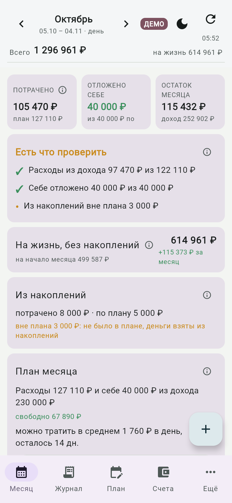
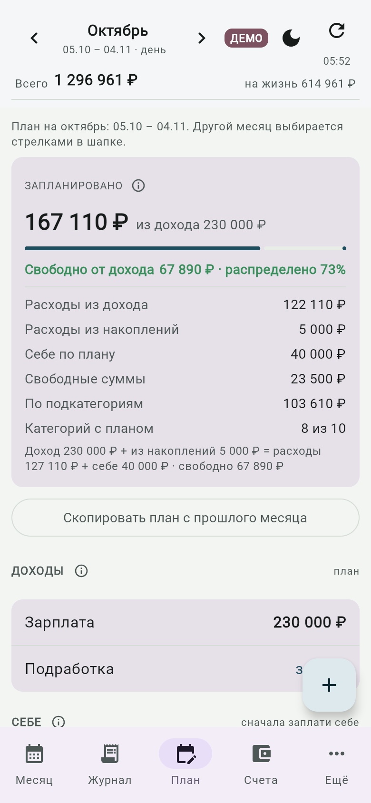
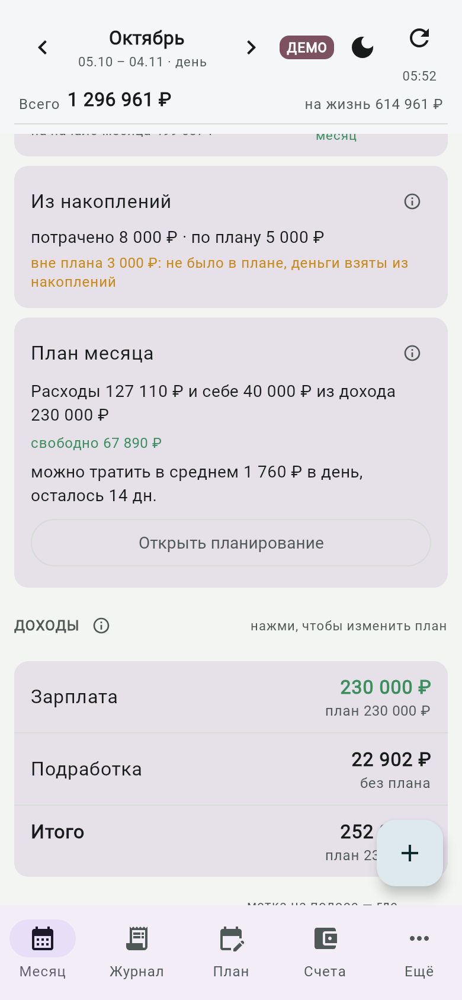
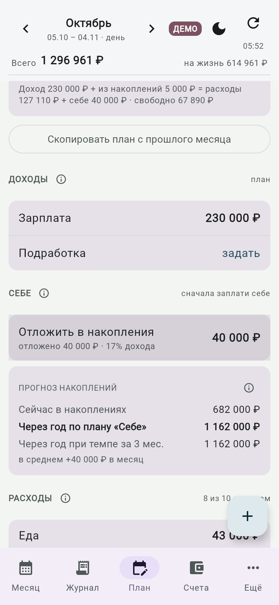
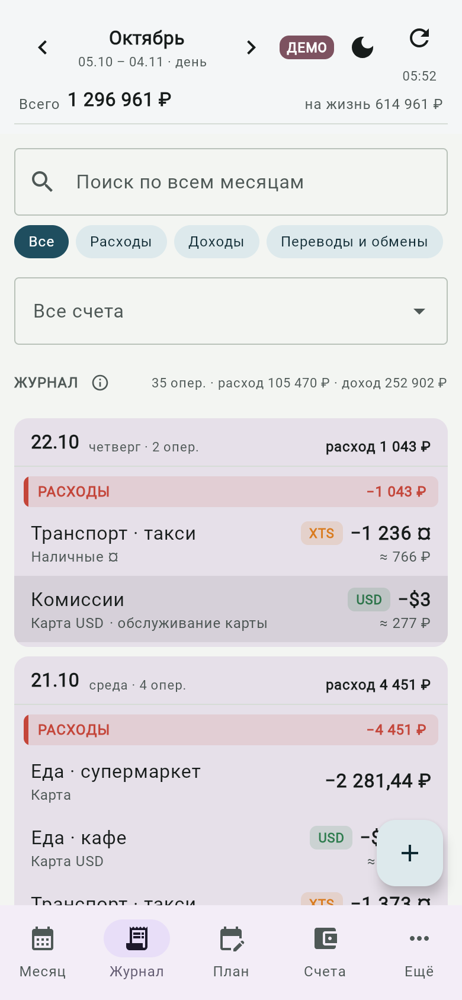
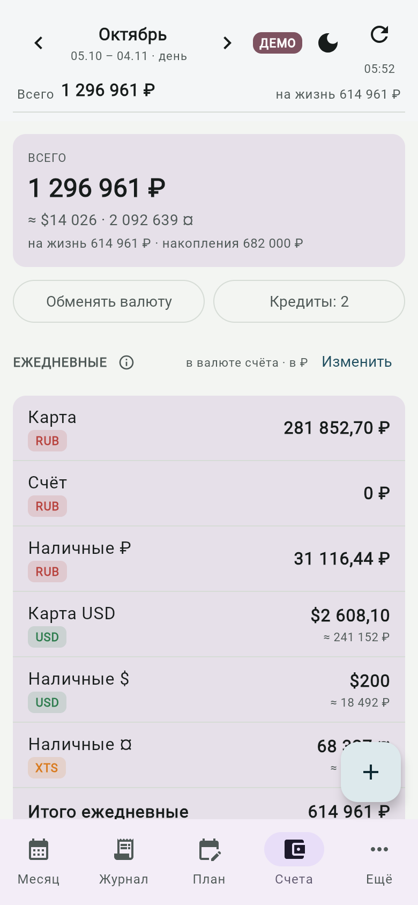

# Планирование: накопления и траты из накоплений

Короткая инструкция. Демо с вымышленными данными: добавьте `?demo` к адресу сайта.

## Идея

Месяц — зарплатный цикл 5→5. У месяца есть баланс:

> доход + расходы из накоплений = все расходы + «Себе»

- **Расходы** — все траты по категориям, независимо от того, откуда взяты деньги.
- **Из накоплений** — траты, оплаченные отложенными деньгами, а не доходом месяца. Источник определяется счётом: списание с накопительного счёта считается тратой из накоплений.
- **«Себе»** — сколько вы хотите отложить в накопления в этом месяце. Платите себе первым.
- **Свободно** — сколько планового дохода ещё не распределено.

Месяц идёт по плану, если расходы из дохода не выходят за план и отложено столько, сколько задано в «Себе». Запланированные траты из накоплений успех не ломают.

## Как спланировать месяц

1. Вкладка **План**. Задайте доход: нажмите на «Зарплата» и введите сумму. Нерегулярный доход, например подработку, не планируйте: он считается бонусом и приходит только по факту.
2. Раздел **Себе**: нажмите «Отложить в накопления», введите сумму или выберите 10, 20 или 30 % от дохода.
3. Раздел **Расходы**: нажмите на категорию и задайте свободную сумму и/или суммы по подкатегориям. План категории — их сумма.
4. Если расход оплатится накоплениями, например аренда или билеты, включите переключатель **«из накоплений»** у этой строки. Такие строки не уменьшают «свободно».
5. Проверьте сводку вверху: строка «Доход + из накоплений = расходы + себе» подскажет, сходится ли план и сколько свободно.

Пример: доход 400 000, на жизнь 300 000, квартира 50 000 и билеты 80 000 из накоплений, «Себе» 100 000. Получается 400 000 + 130 000 = 430 000 + 100 000, план сходится.

## Как записывать траты

Кнопка «+», выберите **счёт списания** сверху. Если это накопительный счёт, трата автоматически считается «из накоплений», дополнительно отмечать ничего не нужно.

## Что показывает экран «Месяц»

- **Итог месяца**: расходы из дохода против плана, «Себе» против цели, траты из накоплений вне плана. Пока месяц идёт, недобранное «Себе» только напоминание, после конца месяца — отклонение.
- **Остаток месяца** считается только по тратам из дохода: траты из накоплений его не уменьшают.
- **Из накоплений**: сколько потрачено, сколько было по плану. Всё сверх плана показано как «вне плана», но категория из-за этого не краснеет.
- **Конверты** (категории): остаток и темп считаются по части из дохода. Под категорией строка «из накоплений».

## Прогноз накоплений

На вкладке План, в разделе «Себе»: сколько в накоплениях сейчас, сколько будет через год по плану «Себе» и сколько при темпе последних трёх закрытых месяцев. Отдельной годовой цели нет, прогноз считается сам.

## Скриншоты

| Месяц | План |
|---|---|
|  |  |
|  |  |
|  |  |

## Что не вошло

Накопительные цели-фонды («Квартира», «Путешествия») с отдельным прогрессом: пока все накопления одним пулом.
